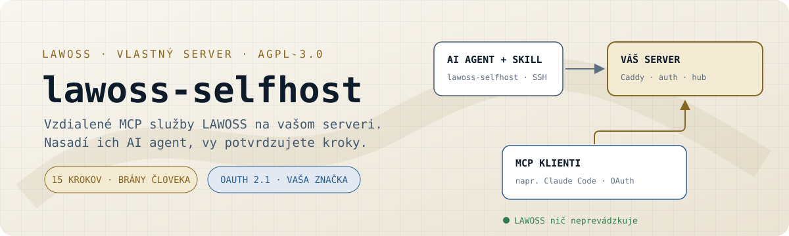
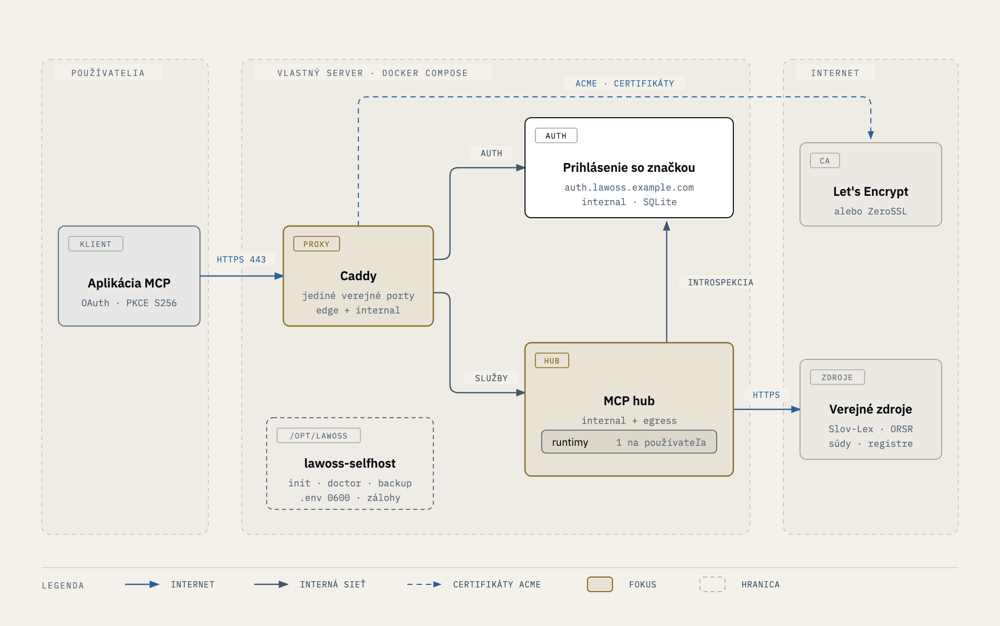
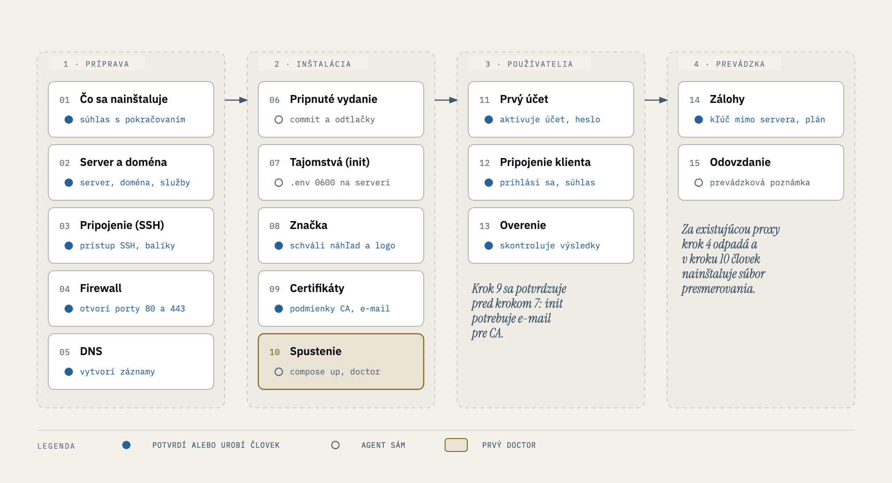
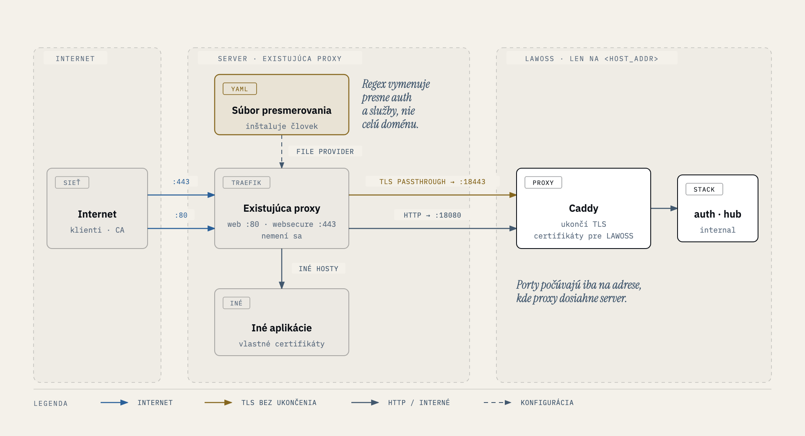
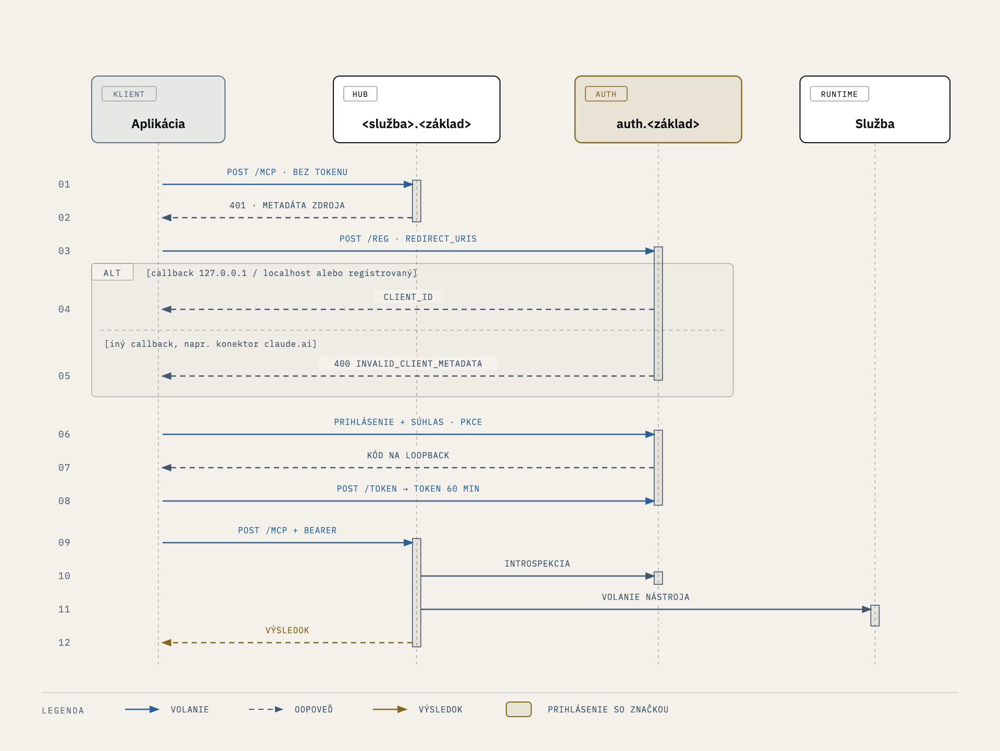

<picture>
  <source media="(prefers-color-scheme: dark)" srcset="docs/assets/lawoss-selfhost-hero-dark.svg">
  
</picture>

# lawoss-selfhost · LAWOSS

<p><strong>Vlastný server</strong> · Vzdialené MCP služby · Vaša infraštruktúra a vaša značka</p>

[Skill lawoss-selfhost](https://github.com/Omni-Legal-Products/lawoss-marketplace/tree/main/plugins/lawoss-selfhost) · [Technická referencia](docs/reference.md) · [Bezpečnosť](SECURITY.md) · [Licencia AGPL-3.0](LICENSE)

Toto je zdrojový softvér, nie prístup k prevádzkovanej službe. LAWOSS nič neprevádzkuje.

`lawoss-selfhost` sprístupní služby LAWOSS (Slov-Lex, ORSR, judikatúra, právne kalkulačky
a ďalšie) ako vzdialené MCP servery na serveri, ktorý vlastníte. Ľudia z vašej kancelárie sa
k nim pripájajú cez prihlásenie s vašou značkou. Nasadenie vedie AI agent podľa skillu
`lawoss-selfhost` z [LAWOSS Marketplace](https://github.com/Omni-Legal-Products/lawoss-marketplace).
Agent pracuje na serveri cez SSH a pri každom kroku povie, čo urobí sám a čo musíte potvrdiť
alebo urobiť vy.

**English summary.** Self-hosted LAWOSS MCP services behind your own branded OAuth sign-in. An AI
agent deploys them on a server you control, following the `lawoss-selfhost` skill in 15 steps with
human confirmation gates. LAWOSS hosts nothing; the operator is responsible for the server, its
users and the terms of the public sources. Technical details are in [docs/reference.md](docs/reference.md).

> [!IMPORTANT]
> Keď `doctor` prejde, nasadenie technicky funguje. Nedokazuje to, že dáta verejných zdrojov sú
> úplné alebo aktuálne, ani že odpoveď je právne správna. Výsledky overujte v oficiálnych zdrojoch.

## Čo to je

Na server sa nainštalujú tri kontajnery a nástroj na správu:

| Časť | Čo robí |
|---|---|
| **Caddy** (proxy) | Jediná časť dostupná z internetu. Pre každý host si sama vydá certifikát, predvolene u Let's Encrypt (pri zlyhaní môže skúsiť ZeroSSL). |
| **auth** | Prihlasovací server OAuth 2.1 so značkou prevádzkovateľa: prihlásenie, aktivácia účtu, súhlas a stránka pomoci. Beží iba vo vnútornej sieti. |
| **hub** | Spúšťa pre prihlásených používateľov tie isté preskúmané služby LAWOSS ako lokálne pluginy, každému používateľovi vlastné procesy s limitmi volaní a súbežnosti. Každá služba má vlastný host a je samostatným OAuth zdrojom. |
| **`lawoss-selfhost`** | Nástroj v `/opt/lawoss`: `init`, `doctor`, účty, kľúče, zálohy, aktualizácie, rotácie. Tajomstvá generuje na serveri a nikdy ich nevypisuje. |

<picture>
  <source media="(prefers-color-scheme: dark)" srcset="docs/assets/lawoss-selfhost-architecture-dark.png">
  
</picture>

Dostupné služby (identifikátory pre `--services`): `crz`, `disq`, `eurlex`, `fs`, `judikaty`,
`kalkulacky`, `orsr`, `ov`, `rpo`, `rpvs`, `ru`, `ruz`, `slovlex`, `uvo`. Na začiatok stačí
`slovlex,orsr,judikaty,kalkulacky,ruz,rpo`. Služba `fs` potrebuje kľúč `FS_API_KEY`; niektoré funkcie
`judikaty`, `eurlex` a `crz` majú voliteľné kľúče. Nástroje, ktoré ukladajú súbory, sú na diaľku
vypnuté a ostávajú v lokálnych pluginoch.

Editovateľné zdroje diagramov: [architektúra](docs/diagrams/lawoss-selfhost-architecture.html) ·
[prihlásenie OAuth](docs/diagrams/lawoss-selfhost-oauth.html) ·
[15 krokov](docs/diagrams/lawoss-selfhost-steps.html) ·
[za existujúcou proxy](docs/diagrams/lawoss-selfhost-existing-proxy.html)

## Pre koho

- Pre kancelárie a tímy, ktoré chcú služby LAWOSS používať z viacerých počítačov a aplikácií
  bez lokálnej inštalácie každého pluginu, s vlastnými účtami a vlastnou značkou.
- Pre toho, kto má (alebo si prenajme) server s Linuxom a doménu a chce, aby nasadenie urobil
  AI agent pod jeho dohľadom. Netreba byť technik; treba vedieť potvrdiť kroky, vytvoriť
  záznamy DNS a bezpečne uložiť kľúč záloh.
- Kto chce služby používať len sám na jednom počítači, vystačí si s
  [lokálnymi pluginmi](https://github.com/Omni-Legal-Products/lawoss-marketplace). Tie ostávajú
  predvolenou cestou.

## LAWOSS nič neprevádzkuje

- Server, doménu a ich náklady má prevádzkovateľ. LAWOSS nič neúčtuje.
- LAWOSS server nespravuje, nesleduje ani neaktualizuje. Každú aktualizáciu spúšťa človek.
- Za server, jeho používateľov a dodržiavanie podmienok verejných zdrojov zodpovedá
  prevádzkovateľ. Verejné zdroje vidia IP adresu servera.
- LAWOSS nezaručuje úplnosť ani aktuálnosť dát verejných zdrojov.

## Požiadavky

| Čo | Odporúčanie |
|---|---|
| Server | Linux s verejnou IPv4 adresou, 4 vCPU a 8 GB RAM pre 1 až 20 používateľov; prístup cez SSH s kľúčom a používateľ s právom `sudo` |
| Limity pamäte | hub 6 GB, auth 512 MB, proxy 256 MB |
| Softvér | Docker Engine s Compose v2 (`docker compose`), `git`; voliteľne `gh` na overenie atestácií obrazov |
| Doména | subdoména, napríklad `lawoss.example.com`; záznamy A pre `auth.lawoss.example.com` a každú službu, alebo jeden záznam `*.lawoss.example.com` |
| Porty | 80 a 443 (TCP) a 443 (UDP), alebo existujúca reverzná proxy Traefik (pozri nižšie) |
| Certifikáty | kontaktný e-mail pre certifikačnú autoritu, najlepšie spoločná adresa prevádzky |
| Disk | pribúdajú obrazy, dáta a zálohy; nástroj staré zálohy sám nemaže |
| Agent | AI agent s prístupom k shellu a SSH, napríklad Claude Code alebo Codex, so skillom `lawoss-selfhost` |

## Rýchly štart s agentom

1. Pridajte si LAWOSS Marketplace a nainštalujte skill `lawoss-selfhost`.

   V Claude Code:

   ```text
   /plugin marketplace add Omni-Legal-Products/lawoss-marketplace
   /plugin install lawoss-selfhost@lawoss
   ```

   V Codexe:

   ```bash
   codex plugin marketplace add https://github.com/Omni-Legal-Products/lawoss-marketplace.git --ref main
   codex plugin add lawoss-selfhost@lawoss
   ```

2. Povedzte agentovi napríklad: *„Nasaď mi vlastný server LAWOSS podľa skillu lawoss-selfhost.
   Server je …, doména lawoss.example.com, služby slovlex, orsr a judikaty.“*

3. Agent prejde 15 krokov. Pri každom povie, čo urobí sám a čo potvrdíte alebo urobíte vy.

<picture>
  <source media="(prefers-color-scheme: dark)" srcset="docs/assets/lawoss-selfhost-steps-dark.png">
  
</picture>

Čo zostáva na vás a nikdy nepatrí do konverzácie s agentom:

- **Heslá, aktivačné odkazy, kľúče poskytovateľov, súkromný kľúč záloh.** Tie zadávate alebo
  otvárate vo vlastnom termináli (samostatné okno alebo samostatné SSH spojenie), nie
  v príkazovom poli agenta.
- **DNS, firewall poskytovateľa a súbor presmerovania** pri existujúcej proxy robíte sami.
- **Podmienky certifikačnej autority** prijímate vy.

> [!NOTE]
> Skill v katalógu `main` dnes pripína vydanie **0.1.0**. Pripnutie vydania **0.2.0** a postup
> za existujúcou reverznou proxy sú v posudzovaní
> v [lawoss-marketplace#58](https://github.com/Omni-Legal-Products/lawoss-marketplace/pull/58).
> Skill vždy použije presne vydanie, ktoré pripína, a hodnoty nepreberá z internetu.

## Ručný postup v skratke

Agent robí presne toto, len s kontrolami a bránami. Príklad pre vydanie 0.2.0; hodnoty `VERZIA`,
commit a odtlačok berte vždy z tabuľky [Publikované vydania](#publikované-vydania) alebo zo skillu.

```bash
# 1. Pripnutý commit
git clone https://github.com/Omni-Legal-Products/lawoss-selfhost.git ~/lawoss-selfhost
cd ~/lawoss-selfhost
git checkout --detach 29440f8af25792e42b4c764f8334ec9be239439b

# 2. Záznam vydania zo skillu (plugins/lawoss-selfhost/skills/lawoss-selfhost/release/0.2.0.json)
sha256sum ~/lawoss-0.2.0.json   # musí byť 425865a7262019e6d77c7b847b9a42cdc8b0c4ae02b9358dd3ed39ccbc5f38b3

# 3. Súbory vydania do /opt/lawoss (overí odtlačky, stiahne iba obraz auth)
sudo sh deploy/install-host-files.sh ~/lawoss-0.2.0.json 425865a7262019e6d77c7b847b9a42cdc8b0c4ae02b9358dd3ed39ccbc5f38b3 .

# 4. Tajomstvá a konfigurácia (vypíše iba názvy hostiteľov)
sudo /opt/lawoss/bin/lawoss-selfhost init --base lawoss.example.com --services slovlex,orsr,judikaty \
  --acme-email ops@example.com --record ~/lawoss-0.2.0.json \
  --record-sha256 425865a7262019e6d77c7b847b9a42cdc8b0c4ae02b9358dd3ed39ccbc5f38b3

# 5. Spustenie a kontrola (iba riadky PASS a FAIL)
sudo docker compose -f /opt/lawoss/compose.yaml --env-file /opt/lawoss/.env up -d
sudo /opt/lawoss/bin/lawoss-selfhost doctor

# 6. Prvý účet (vypíše iba cestu k súboru 0600 s aktivačným odkazom, platí 1 hodinu)
sudo /opt/lawoss/bin/lawoss-selfhost invite jnovak slovlex,orsr,judikaty

# 7. Zálohy
sudo /opt/lawoss/bin/lawoss-selfhost backup init-key
sudo /opt/lawoss/bin/lawoss-selfhost backup
sudo /opt/lawoss/bin/lawoss-selfhost restore --dry-run
```

Pred krokom 4 musia byť hotové záznamy DNS a otvorené porty. `init` vyžaduje kontaktný e-mail pre
certifikačnú autoritu a `.env` už nikdy neprepíše. Aktivačný odkaz otvorte vo vlastnom termináli
a súbor potom zmažte. Súkromný kľúč záloh skopírujte mimo servera; bez neho sa žiadna záloha nedá
obnoviť. Podrobnosti ku každému príkazu sú v [technickej referencii](docs/reference.md#setup-cli).

### Za existujúcou reverznou proxy

Ak porty 80 a 443 už drží Traefik (napríklad v Dokploy alebo Coolify), Caddy beží za ním. `init`
dostane navyše dva voľné porty a adresu, na ktorej kontajner proxy dosiahne server
(od vydania 0.2.0):

```bash
sudo /opt/lawoss/bin/lawoss-selfhost init ... --http-port 18080 --https-port 18443 --proxy-bind HOST_ADDR
```

<picture>
  <source media="(prefers-color-scheme: dark)" srcset="docs/assets/lawoss-selfhost-existing-proxy-dark.png">
  
</picture>

- Traefik posiela TLS pre `auth` a zvolené služby **bez ukončenia** (TLS passthrough podľa SNI)
  na port HTTPS Caddy a HTTP z portu 80 na port HTTP Caddy. Caddy si certifikáty vydáva sám.
- Pravidlo `HostSNIRegexp` vymenuje presne `auth` a zvolené služby, napríklad
  `^(auth|slovlex|orsr|judikaty)\.lawoss\.example\.com$`. Nikdy nezachytí celú doménu, lebo na
  zdieľanej proxy by tým iným aplikáciám zobral TLS.
- Porty LAWOSS počúvajú iba na `HOST_ADDR`, nie na všetkých adresách. Firewall sa nemení.
- Súbor presmerovania (dynamická konfigurácia Traefiku, poskytovateľ `file`) pripraví agent
  a nainštaluje človek. Konfiguráciu Traefiku agent nemení a Traefik ani Dokploy nereštartuje.
  Pri odstránení nasadenia treba súbor odstrániť aj z proxy.
- Klienti používajú port 443; adresy vydavateľa a služieb port neobsahujú.

Vzorová konfigurácia Traefiku je v [technickej referencii](docs/reference.md#behind-an-existing-reverse-proxy).

## Pripojenie aplikácie

Každá služba má adresu `https://<služba>.<základná doména>/mcp`, napríklad
`https://slovlex.lawoss.example.com/mcp`. Adresa je pre MCP klienta, nie pre prehliadač
(prehliadač ukáže prázdnu stránku). Koreň `https://auth.lawoss.example.com` ukazuje len stránku
pomoci; prihlásenie sa otvorí samo, keď klient pridá službu.

V Claude Code:

```bash
claude mcp add --transport http lawoss-slovlex https://slovlex.lawoss.example.com/mcp
```

Potom v `/mcp` zvoľte **Authenticate**, prihláste sa a udeľte súhlas. Návod na používanie
služieb na diaľku dáva plugin `lawoss-remote-skills` z LAWOSS Marketplace.

<picture>
  <source media="(prefers-color-scheme: dark)" srcset="docs/assets/lawoss-selfhost-oauth-dark.png">
  
</picture>

> [!WARNING]
> **Známe obmedzenie: konektory Claude desktop a claude.ai sa zatiaľ nepripoja.** Auth server pri
> dynamickej registrácii klienta prijme iba callback na loopback (`http://127.0.0.1`, `[::1]`,
> `localhost`) alebo callback výslovne zapísaný v konfigurácii auth. Vlastný konektor v Claude
> desktop a claude.ai používa callback `https://claude.ai/api/mcp/auth_callback`, preto
> registrácia skončí chybou `400 invalid_client_metadata` a pripojenie zlyhá. Nástroj
> `lawoss-selfhost` vo vydaní 0.2.0 nemá voľbu, ktorou by sa callback zapísal. Overené funguje
> Claude Code, ktorý používa loopback callback.

## Prevádzka

Príkazy sa spúšťajú ako `sudo /opt/lawoss/bin/lawoss-selfhost …`. Rovnaké brány ako pri nasadení
platia aj neskôr: agent pripraví príkaz, človek potvrdí.

| Úloha | Príkaz | Čo robí |
|---|---|---|
| Kontrola | `doctor` | DNS, TLS a HTTP cez `127.0.0.1:443` so SNI každého hostiteľa, metadáta, cestu hub → auth a nástroje každej služby |
| Aktualizácia | `update --to VERZIA --record … --record-sha256 …` | urobí snímku, prepne obrazy, spustí `doctor`; pri zlyhaní vráti `.env`, Caddyfile aj súbory vydania |
| Návrat | `rollback` | vráti súbory a obrazy predchádzajúceho vydania; medzitým vymenené tajomstvá ostanú |
| Návrat zo snímky | `restore-snapshot /opt/lawoss/snapshots/ČAS` | vráti stav presne zo snímky vrátane dát |
| Zálohy | `backup init-key`, `backup` | zálohy sa šifrujú verejným kľúčom; súkromný kľúč patrí mimo servera |
| Obnova | `restore --dry-run`, `restore --apply …` | skontroluje alebo obnoví zálohu, aj na novom serveri |
| Rotácie | `rotate introspection`, `rotate cookies`, `rotate signing` | vymení tajomstvá služieb, kľúč súborov cookie alebo podpisový kľúč |
| Služby | `services add ID`, `services remove ID` | zmení konfiguráciu auth, hubu aj Caddy; nový host potrebuje záznam DNS |
| Účty | `invite`, `list`, `disable` | pozvánka s jednorazovým odkazom, prehľad, okamžité zablokovanie |
| Kľúče | `set-key FS_API_KEY` | kľúč poskytovateľa zo skrytého vstupu v termináli človeka |
| Značka | `brand check`, `brand preview`, `brand set` | kontrola, náhľad a nastavenie vlastného loga a farieb |

Nové vydanie prichádza iba s novým preskúmaným commitom katalógu LAWOSS, ktorý pripne nový commit,
záznam vydania a obrazy. Pred aktualizáciou si prečítajte poznámku k vydaniu.

## Bezpečnostný model

- **Tajomstvá vznikajú na serveri.** `init` ich zapíše do `/opt/lawoss/.env` (0600, iba root).
  Nástroj vypisuje iba názvy hostiteľov, riadky `PASS`/`FAIL` a cesty k súborom 0600, nikdy
  tajomstvo, kľúč, aktivačný odkaz ani heslo. Skill navyše zakazuje agentovi príkazy, ktoré by
  tajomstvá vypísali (`cat .env`, `docker compose config`, logy kontajnerov a podobne).
- **Iba proxy je dostupná z internetu.** Caddy je v sieťach `edge` a `internal`, auth iba
  v `internal` (bez prístupu do internetu), hub v `internal` a `egress`. Žiadny kontajner nedostane
  socket Dockeru.
- **Odolné kontajnery.** Súborový systém iba na čítanie, odobraté všetky capabilities,
  `no-new-privileges`, limity pamäte a procesov.
- **Overené vydanie.** Záznam vydania je pripnutý odtlačkom SHA-256 v katalógu LAWOSS, obrazy
  odtlačkom (digestom). Ak je nainštalovaný `gh`, `init` a `update` overia atestácie obrazov auth
  a hub a pri zlyhaní odmietnu pokračovať. Obraz Caddy atestáciu nemá; platí preň iba odtlačok.
- **OAuth 2.1.** PKCE S256 je povinné, prístupový token platí 60 minút a obnovovací token sa pri
  použití mení. Každý host služby je samostatný OAuth zdroj; hub overuje každý token v auth
  tajomstvom danej služby.
- **Preskúmané nástroje.** Hub púšťa iba nástroje uvedené v preskúmanom manifeste
  `hub/services.json`.

### Známe zvyškové riziko

- **Služby bežia pod tým istým používateľom ako hub aj ako ostatné služby.** Ak by niekto zneužil
  chybu v niektorej službe (spracúvajú PDF a HTML z verejných portálov), mohol by prečítať
  tajomstvá hubu vrátane kľúčov poskytovateľov a priečinky iných používateľov. Oddelenie je
  plánované, zatiaľ nie je hotové. Pri podozrení spustite `rotate introspection` a vymeňte kľúče
  poskytovateľov cez `set-key`.
- **Manifest pripína názvy nástrojov, nie ich argumenty.** Nový nástroj je zakázaný, kým ho
  niekto nepreskúma, ale nový argument existujúceho nástroja sa zatiaľ automaticky nezistí. Pri
  každej zmene commitu katalógu treba argumenty skontrolovať ručne.
- Ak sa tajomstvo objaví v akomkoľvek výstupe, vymeňte ho (`rotate`, `set-key`). Súkromný kľúč
  záloh držte mimo servera; bez neho sa žiadna záloha nedá obnoviť.

Podrobnosti a hlásenie zraniteľností: [SECURITY.md](SECURITY.md).

## Publikované vydania

| Verzia | Dátum | Commit | SHA-256 záznamu vydania |
|---|---|---|---|
| 0.2.0 | 2026-11-19 | `29440f8af25792e42b4c764f8334ec9be239439b` | `425865a7262019e6d77c7b847b9a42cdc8b0c4ae02b9358dd3ed39ccbc5f38b3` |
| 0.1.0 | 2026-11-18 | `d041ee6fb116a65dde7201fb4c7d15bbb0b51256` | `6f96cd390968ecfee44c34057b5d61705391ffa91953791cb463d286edfcedde` |

0.2.0 pridáva voliteľné porty proxy (pozri [Za existujúcou reverznou proxy](#za-existujúcou-reverznou-proxy)).

Obrazy vydania 0.2.0:

- auth: `ghcr.io/omni-legal-products/lawoss-auth@sha256:014b41f319cc634bea50aee8a14380bbf6623ee56a3041d7912396f3e636dde7`
- hub: `ghcr.io/omni-legal-products/lawoss-hub@sha256:c9bd106d579e842109052b73e0f2e179bdbe440cb7936c41dd62d23bc12f7714`
- proxy: `caddy:2.11.9@sha256:4851e54a46b206517c574821bb5cc67f170d2156041e9fbc4c9193b45e84a75b`

Obrazy vydania 0.1.0:

- auth: `ghcr.io/omni-legal-products/lawoss-auth@sha256:93e84a8a52d3286b07cc1fd231dc4d679db5e15ecf27daf8dc510876390bc1ea`
- hub: `ghcr.io/omni-legal-products/lawoss-hub@sha256:c86179af9093b1b26405da51aedcd343e66b33bf90a61018a21e12e08e667ea7`
- proxy: `caddy:2.11.9@sha256:4851e54a46b206517c574821bb5cc67f170d2156041e9fbc4c9193b45e84a75b`

Pôvod obrazu overíte príkazom
`gh attestation verify oci://IMAGE --repo Omni-Legal-Products/lawoss-selfhost`.

Záznamy vydaní nie sú v tomto repozitári. Každý beh workflowu vydania ich uchová ako artefakt
`release-<verzia>` na 90 dní (0.1.0 do 2027-02-16, 0.2.0 do 2027-02-17). Trvalá kópia je v LAWOSS
Marketplace: skill `lawoss-selfhost` obsahuje záznam vydania, ktoré pripína
(`plugins/lawoss-selfhost/skills/lawoss-selfhost/release/<verzia>.json`), a `releases.json`
pripína jeho SHA-256; záznamy starších vydaní ostávajú v histórii marketplace. Záznam uložte ako
`releases/<verzia>.json` do checkoutu jeho commitu a pred použitím overte jeho SHA-256.

## Pre vývojárov

Stavba, testy, manifest hubu, nástroj na nasadenie a workflow vydaní sú opísané
v [technickej referencii](docs/reference.md). Prihlasovací server v `auth/` je exportovaný
z commitu uvedeného v `auth/SOURCE_COMMIT`; zmeny v ňom prichádzajú s ďalším exportom. Pravidlá
pre prispievateľov a agentov sú v [AGENTS.md](AGENTS.md).

## Licencia

AGPL-3.0, pozri [LICENSE](LICENSE). Písma v `auth/brand/*/fonts` sú pod licenciou SIL Open Font
License 1.1.
